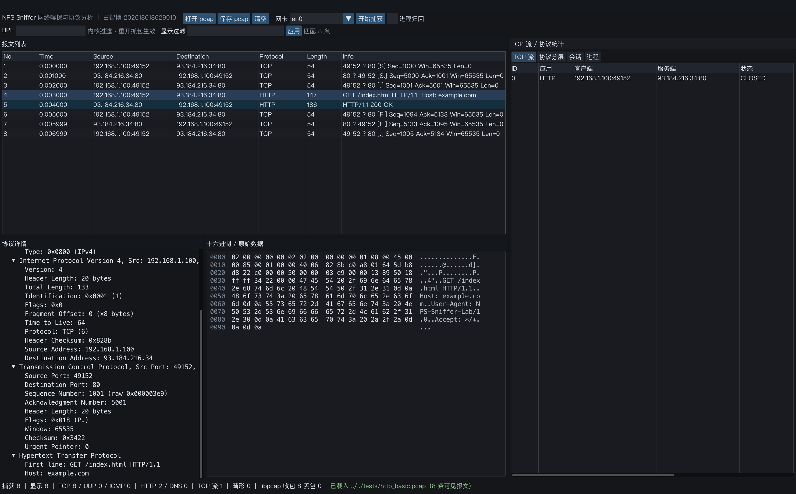
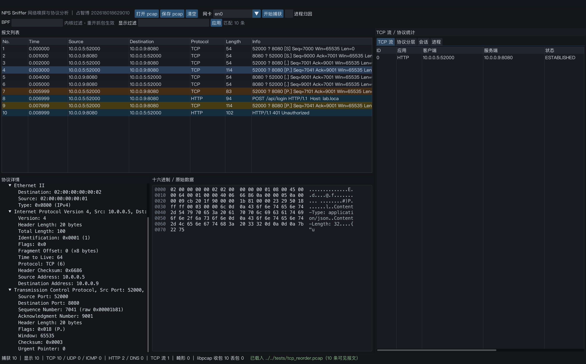
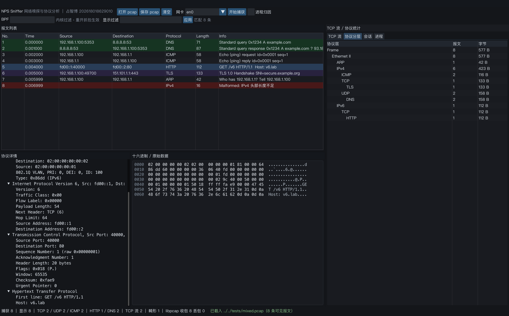
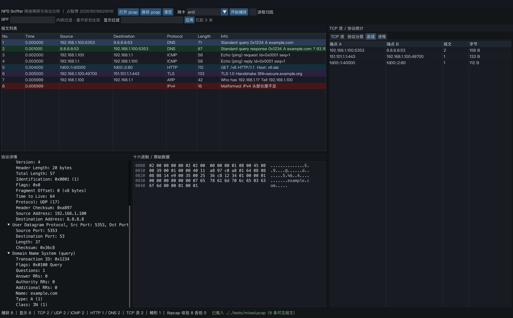
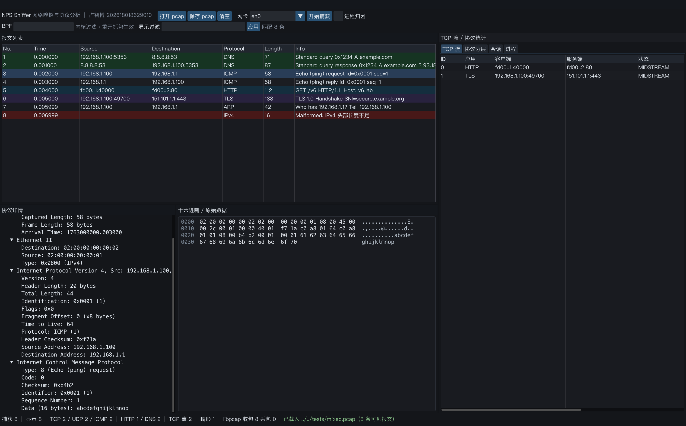

\newpage

# 1　实验概述

本实验实现了一个自研的网络嗅探与协议分析工具 **NPS Sniffer**（Network Packet Sniffer），
包含命令行程序 `nps-cli` 与图形界面程序 `nps-gui`。工具基于 libpcap 完成抓包，
自行实现链路层到应用层的协议解析、类 Wireshark 的显示过滤器、TCP 流追踪与重组、
应用层内容还原，以及把 TCP 连接归因到本机进程的进程级归因能力。
界面使用 SDL2 + Dear ImGui 自行绘制，不依赖任何抓包软件的前端。

全部代码约 5000 行 C++17，分为与界面无关的核心静态库 `nps_core` 和两个前端，
同一套解析/分析代码同时服务于 GUI 与 CLI，保证两端的结论一致、可交叉验证。

## 1.1 需求与完成度对照

| 评分层次 | 要求 | 本实现 | 验证方式 |
|:-------|:-----------------|:--------------------------------------------------------------------|:-----------------------|
| 及格 | 能捕获并显示数据包 | libpcap 实时抓包 + 离线 pcap 回放；报文列表显示序号、时间、源/目的、协议、长度、摘要 | `nps-cli`/`nps-gui` 载入 4 个测试 pcap；实时抓包代码同源（需 root） |
| 基础 | 协议分析（NPA） | Ethernet/802.1Q VLAN/ARP/IPv4/IPv6/ICMP/ICMPv6/TCP(含选项)/UDP/DNS/HTTP/TLS(SNI) 共 13 类协议，字段树 + 十六进制联动 | 图 1–图 6 与第 5 节功能测试 |
| 加分 | TCP 流追踪 / 进程级归因 / Wireshark 二次开发（任选） | 实现了前两项，并额外提供自研 GUI：五元组流归并、SEQ 重排、乱序/重传判定、握手 RTT、HTTP 请求/响应还原；macOS/Linux/Windows 三平台进程归因 | 图 2、图 3 与 5.2 节的乱序/重传统计 |
| 工程性 | 代码开源、保留 Git 记录 | 源码目录独立 `git` 仓库，含构建脚本与测试样本生成器 | `git log` |

## 1.2 运行环境

| 项目 | 说明 |
|:----|:--------------------------------------------------------------|
| 开发/验证平台 | macOS 14（Apple Silicon），AppleClang 16，CMake 3.16+ |
| 依赖 | libpcap（系统自带）、SDL2、Dear ImGui 1.91.8（`third_party` 内置）、stb_image_write |
| 跨平台 | Linux 直接可用；Windows 需 Npcap SDK（CMake 中已给 `NPCAP_SDK_DIR` 分支） |
| 实测数据 | 200 000 条报文 / 23.6 MB 的合成 pcap，离线解析约 2.4 s（约 8.3 万包/秒、约 9.8 MB/s） |

# 2　系统设计

## 2.1 总体架构

系统按“采集—解析—分析—呈现”四层划分，层与层之间只通过数据结构耦合，
解析与分析部分不出现任何界面代码，因此同一份 `nps_core` 既能被 GUI 调用，
也能被 CLI 用于批量回归测试（图 0）。

{width=100%}

## 2.2 线程模型与数据流

抓包与解析分属两个线程，中间用有界队列衔接：

- **采集线程**：libpcap 回调把 `pcap_pkthdr + 数据` 拷贝成 `RawPacket`，投递到 `Analyzer` 队列；
  队列超过 50 万条时丢弃并计数，避免消费者卡顿时内存无上限增长。
- **分析线程**：批量取出（每批最多 4096 条）后依次执行 `Dissector::dissect` →
  `StreamTracker::process` → 统计聚合；每 2 s 刷新一次进程连接表。
- **界面线程**：每帧只做一次加锁快照（`streamsUnlocked()` 等），不跨线程持有引用，
  因此大流量下界面不会因为解析线程持有锁而卡死。

离线分析走同一条流水线，只是由 `readOfflineAll()` 同步灌入队列后 `waitIdle()` 等待排空，
保证离线与实时两条路径的解析结果完全一致。

## 2.3 核心数据结构

`Packet` 保存一条报文的全部解析结果：链路层（MAC、VLAN）、网络层（地址、TTL、分片）、
传输层（端口、SEQ/ACK、窗口、标志、载荷偏移）、应用层（协议名、摘要）以及用于界面联动的
`FieldNode root` 字段树。字段树的每个节点都带 `offset/length`，指向原始字节缓冲区，
这是“点击字段→十六进制高亮”能够精确到字节的基础。

```cpp
struct FieldNode {
    std::string name;      // e.g. "Source Address"
    std::string value;     // e.g. "93.184.216.34"
    size_t offset = 0;     // 在 Packet::raw 中的起始偏移
    size_t length = 0;
    std::vector<FieldNode> children;
};
```

# 3　关键实现

## 3.1 抓包引擎

`CaptureEngine` 封装 libpcap 的实时与离线两种模式，并统一了错误处理与统计口径。
实时抓包的关键参数如下（`capture.cpp`）：

```cpp
pcap_set_snaplen(handle_, 262144);        // 保存完整帧，便于后续重组
pcap_set_timeout(handle_, 100);           // 100 ms 交付一批，兼顾延迟与吞吐
pcap_set_buffer_size(handle_, 16 << 20);  // 16 MB 内核缓冲，降低高pps下的丢包
pcap_set_immediate_mode(handle_, 1);      // 关闭内核聚合，交互式观察更及时
pcap_set_promisc(handle_, 1);
```

BPF 过滤器在 `pcap_activate()` 之前用 `pcap_compile/pcap_setfilter` 下发到内核，
被过滤掉的报文不会进入用户态，这正是 BPF 相对用户态过滤的性能优势（见 6.1 节）。
抓包同时可用 `pcap_dump` 落盘，界面上的“保存 pcap”则用 `pcap_open_dead` +
`pcap_dump` 把当前已解析的报文重新写出，二者共用同一套时间戳换算。

## 3.2 协议解析

解析器采用“逐层剥离 + 统一边界检查”的写法：每一层都先用
`ok(offset, need)` 校验剩余长度，失败即写 `malformed=true` 并停止深入，
绝不越界读取，也不抛异常。这样畸形帧只会让当前报文变红，不影响后续报文。

```cpp
struct Cursor {                 // 解析上下文
    const uint8_t* d; size_t len;
    bool ok(size_t off, size_t need) const { return off <= len && need <= len - off; }
};

// IPv4：先校验首部长度与总长度，再按 protocol 分发
const size_t ihl = (d[0] & 0x0f) * 4;
if (ihl < 20 || !c.ok(0, ihl)) { malformed("IPv4 首部长度不足"); return; }
```

已实现的协议细节包括：

- **Ethernet / 802.1Q**：识别 0x8100 VLAN 标签并在字段树中单列；
- **ARP**：请求/应答、发送方/目标 MAC 与 IP；
- **IPv4**：分片标志与片偏移（非首片不再尝试解析传输层）、TTL、首部校验和展示；
- **IPv6**：流标签、下一头部、扩展头部跳过（含分片头）；
- **ICMP/ICMPv6**：类型/代码、echo 标识与序号、载荷；
- **TCP**：完整选项解析（MSS、SACK、窗口扩大、时间戳、NOP/EOL），窗口、校验和、标志位逐步展开；
- **UDP**：长度、校验和；
- **DNS**：事务 ID、标志（QR/Opcode/TC/RD/RA）、四个计数字段，以及问题段的
  域名（支持压缩指针 0xC0）、类型与类；
- **HTTP**：请求行/状态行、Host、User-Agent、Content-Length、正文预览；
- **TLS**：记录层版本与类型，ClientHello 中逐层跳转扩展，取出 SNI 明文域名。

以 TLS SNI 为例，必须严格按 `version(2) + random(32) + session_id + cipher_suites +
compression + extensions` 的顺序跳过变长字段，任何一步长度不足都要放弃：

```cpp
size_t o = base + 9;                 // record header(5) + handshake header(4)
o += 34;                             // version(2) + random(32)
o += 1 + c.d[o];                     // session_id
o += 2 + readBe16(c.d + o);          // cipher_suites
o += 1 + c.d[o];                     // compression_methods
const uint16_t extLen = readBe16(c.d + o); o += 2;
while (o + 4 <= std::min<size_t>(o + extLen, c.len)) {   // 遍历扩展
    const uint16_t type = readBe16(c.d + o), len = readBe16(c.d + o + 2);
    if (type == 0) { /* server_name：取列表首项的 host_name */ }
    o += 4 + len;
}
```

## 3.3 显示过滤器

显示过滤器是独立于 BPF 的第二层过滤，作用于已解析的报文，支持
`and/or/not`、括号、比较运算（`== != > < >= <=`）、`contains`，
字段覆盖 `ip.src/ip.dst/ip.addr`、`ipv6.*`、`eth.src/eth.dst`、`tcp.port/tcp.stream/tcp.flags`、
`udp.port`、`frame.len/frame.number`、`http.host/http.request.method/http.response.code`、
`proc.pid/proc.name` 等，以及 `tcp/udp/http/dns/tls/icmp/arp/ip/ipv6` 这类协议布尔判断。

实现分三步：词法分析（处理 `&&`/`||`/`!` 到 `and`/`or`/`not` 的别名、字符串引号与转义）→
递归下降构造 AST（`or → and → not → primary`）→ 逐包求值。
数值字段缺省时按 `!= 0` 处理，与 Wireshark 的习惯保持一致。例如：

```
http or dns                 # 只看 HTTP 与 DNS
tcp and port == 80          # 端口比较
not arp and ip.src == 192.168.1.100
http.response.code >= 400
```

## 3.4 TCP 流追踪与重组

流表以规范化五元组为键：把 (IP, 端口) 两个端点排序后再拼接，
使 `A→B` 与 `B→A` 落进同一条流，同时以 SYN 方向确定客户端/服务端角色；
若中途才抓到报文（MIDSTREAM），则以先出现的端点作为客户端。

重组按方向维护 `baseSeq`、已按序拼接的 `data` 和乱序缓存 `pending`（相对序号的 map）。
判定规则如下：

- `rel < 0` 或写入区间完全落在已收数据内 → **重传**；
- 部分重叠 → 记为重传，只追加未覆盖的尾部；
- `rel > data.size()` → 出现空洞，**乱序**，先放入 `pending`，等缺口补齐后连续回填；
- SYN 占用 1 个序号，因此 `baseSeq = seq + 1`，避免把首个数据段误判为乱序。

```cpp
const int64_t rel = static_cast<int32_t>(p.seq - dir.baseSeq);   // 32 位回绕安全
if (rel < 0) { retrans = true; return; }
const size_t r = (size_t)rel;
if (r < dir.data.size()) { retrans = true; /* 只追加 overlap 之后的部分 */ }
else if (r == dir.data.size()) { append(data, len); }
else { ooo = true; dir.pending[r] = payload; }                   // 先缓存，后面再填补
```

HTTP 还原采用增量解析：以 `\r\n\r\n` 定位首部结束，再按 `Transfer-Encoding: chunked`、
`Content-Length`、无正文状态码（204/304/101）三种情况计算消息边界；
数据不足时保留解析位置等待下一段到达。每条流最多保留 200 条消息、每条消息最多 4 KB 文本，
流内重组缓冲上限 512 KB，防止长时间大流量拖垮内存。

此外，流表还统计握手 RTT（SYN 与 SYN/ACK 的时间差）、载荷字节数、重传/乱序次数与连接状态
（`SYN_SENT`/`ESTABLISHED`/`CLOSED` 等），并在界面右侧“TCP 流”页展示。

## 3.5 进程级归因

`ProcessMap` 周期性采集系统 TCP 连接表，把 (本地 IP:端口, 远端 IP:端口) 与流表匹配，
从而回答“这条连接属于哪个进程”。三个平台分别使用：

- **macOS**：`popen("lsof -nP -iTCP")`，按 `p`/`c`/`n` 行解析 PID、进程名与 `本地->远端`；
- **Linux**：读取 `/proc/net/tcp` 与 `/proc/net/tcp6`（小端十六进制地址），再用
  `/proc/<pid>/fd` 的 socket inode 反查 PID；
- **Windows**：`GetExtendedTcpTable(TCP_TABLE_OWNER_PID_ALL)` + `QueryFullProcessImageName`。

归因结果写入 `Packet::pid/procName` 与 `TcpStream::pid/procName`，
因此过滤器可以直接写 `proc.name contains curl`。该功能只在实时抓包时有意义
（离线 pcap 的端口早已释放），界面以复选框开关，并在“进程”页显示采集状态与连接表。

## 3.6 图形界面

界面为四面板布局：左上报文列表、左下协议字段树、右下十六进制、右侧统计页，
面板之间是可拖动的分隔条，右侧统计页有四个标签：TCP 流 / 协议分层 / 会话 / 进程。
渲染使用 SDL2 的 Renderer2 后端 + Dear ImGui，中文字体为 PingFang，
十六进制视图是自绘的等宽网格，字段被点击后按 `offset/length` 画高亮矩形并自动滚动到对应行。

两个工程细节值得记录：

1. **Retina 缩放**：初期界面整体被放大 2 倍且右侧被裁掉，原因是把 `io.DisplaySize`
   设成了逻辑尺寸、同时又把 `DisplayFramebufferScale` 设为 2，ImGui 于是按 2 倍绘制。
   修正为“一律按物理像素布局”——`DisplaySize = 帧缓冲尺寸`、`DisplayFramebufferScale = (1,1)`，
   字体按 `16 * dpiScale` 加载，鼠标坐标再乘回缩放比。
2. **截图时机**：`SDL_RenderReadPixels` 必须在 `SDL_RenderPresent` **之前**调用，
   否则 macOS 上读到的可能是已被回收的帧缓冲（表现为全黑或花屏）。

界面支持 `--screenshot` 单帧截图和 `--record` 逐帧录制（见第 7 节演示视频）。

## 3.7 命令行

`nps-cli` 复用同一套核心库，面向可复现验证与脚本化测试：

```
nps-cli --read <file.pcap> [--bpf expr] [--filter expr] [--streams] [--http] [--procs] [--json]
nps-cli --live <device> --seconds 10 [--dump out.pcap] [--bpf "tcp port 443"]
nps-cli --list-devices
```

`--json` 输出机器可读的汇总（报文数、各协议计数、流数、重传/乱序数、分层与会话表），
便于和 Wireshark 的 `tshark` 统计结果做对照。

# 4　测试与验证

## 4.1 测试样本

样本由 `tests/gen_pcap.py` 以纯 Python 手工构造（不依赖 scapy），便于复现：

| 文件 | 内容 | 验证点 |
|---|---|---|
| `http_basic.pcap` | 8 条：三次握手 + GET/200 + 四次挥手 | TCP 状态机、HTTP 还原、RTT |
| `tcp_reorder.pcap` | 10 条：HTTP POST 被拆段，含 1 次重传、2 次乱序 | 乱序缓存与重排、重传判定 |
| `mixed.pcap` | 8 条：ARP、ICMP、DNS×2、TLS ClientHello、IPv6+HTTP、802.1Q 与畸形帧 | 多协议分发、SNI、IPv6、畸形帧容错 |
| `perf_200k.pcap` | 200 000 条 / 23.6 MB 合成 TCP 流量 | 吞吐与内存 |

## 4.2 功能验证结果

`nps-cli --read ../tests/http_basic.pcap --streams --http`：

```
报文总数        : 8
TCP/UDP/ICMP    : 8 / 0 / 0
HTTP/DNS        : 2 / 0
TCP 流          : 1（重传 0，乱序 0）
=== 协议分层 ===
Frame → Ethernet II → IPv4 → TCP → HTTP            8 报文 657 B
=== TCP 流 ===
ID 客户端                 服务端                状态     报文 载荷字节 重传 乱序 RTT(ms)
0  192.168.1.100:49152    93.184.216.34:80      CLOSED   8    225      0    0    1.00
=== HTTP 还原 ===
[stream 0] GET /index.html HTTP/1.1
[stream 0] HTTP/1.1 200 OK
```

`nps-cli --read ../tests/tcp_reorder.pcap --streams` 得到 `重传 1，乱序 2`，
且仍还原出 `POST /api/login HTTP/1.1` 与 `HTTP/1.1 401 Unauthorized`，
说明乱序段在缺口补齐后被正确拼接、HTTP 边界未被打断。

`mixed.pcap` 的汇总为 `TCP 2 / UDP 2 / ICMP 2`、`HTTP 1 / DNS 2`、`畸形 1`，
分层统计能正确显示 ARP、ICMP、DNS、TLS、IPv6→TCP→HTTP 五条分支。

{width=100%}

{width=100%}

{width=100%}

{width=100%}

{width=100%}

{width=100%}

## 4.3 性能测试

| 指标 | 数值 |
|---|---|
| 样本 | 200 000 条 / 23 600 000 字节 / 60 000 条 TCP 流 |
| 端到端耗时（含建流与统计） | 2.41 s（`/usr/bin/time`，Release `-O2`） |
| 吞吐 | 约 83 000 包/秒，约 9.8 MB/s |
| 丢包 | libpcap 统计 received=200000, dropped=0（离线无丢包语义） |

该样本的乱序计数偏高，是因为生成器把 6 万条流的首包交错排列，同一流的后续报文
在序号上确实存在空洞，属于合成数据的特性而非实现缺陷；因此报告只引用其吞吐数据。

# 5　遇到的问题与解决

1. **Retina 下界面被整体放大 2 倍并裁切**。定位过程：先怀疑字体过大，改字号无效；
   再打印 `io.DisplaySize` 与 `SDL_GetRendererOutputSize`，发现二者相差 2 倍，
   而 `DisplayFramebufferScale` 又被手动设为 2，ImGui 把已经乘以 2 的尺寸再放大一次。
   改为统一使用物理像素布局后解决，同时保留鼠标坐标的 `* dpiScale` 换算。
2. **截图全黑**。`SDL_RenderReadPixels` 原本放在 `SDL_RenderPresent` 之后，
   macOS 的 Metal 后端在 Present 后可能已回收后台缓冲。把读回移到 Present 之前解决。
3. **中文全角标点显示为方块**。ImGui 的 `GetGlyphRangesChineseFull()` 不含
   `（）`、`，`、`→` 等符号，用 `ImFontGlyphRangesBuilder` 追加
   `U+2000–206F`、`U+3000–303F`、`U+FF00–FFEF` 三段后正常。
4. **大流量下界面卡顿**。最初每帧都在锁内复制全部流表与分层表，改为每 0.8 s
   刷新一次快照、列表用 `ImGuiListClipper` 只绘制可见行后，6 万条流仍可流畅滚动。
5. **畸形帧导致解析崩溃**。早期直接按偏移取字段，遇到截断帧会越界。
   统一改成 `Cursor::ok()` 前置校验 + `malformed` 标记后，`mixed.pcap` 中的
   16 字节畸形 IPv4 帧被标红而不再影响后续报文。

# 6　思考题

## 6.1 抓包与协议分析的层次如何划分？

从下往上看，一条报文要经过四个性质不同的层次，它们的**职责边界**和**性能代价**差别很大：

| 层次 | 典型实现 | 输入/输出 | 代价与位置 |
|---|---|---|---|
| 采集（capture） | libpcap / Npcap / PF_RING | 网卡 DMA → 内核缓冲 → 用户态缓冲 | 每包一次拷贝，受 pps 与 snaplen 约束 |
| 过滤（filter） | BPF 字节码 | 原始帧 → 保留/丢弃 | 在内核中执行，代价与包数成正比但与协议无关 |
| 解析（dissect） | 本项目的 Dissector / tshark | 原始帧 → 结构化字段 | 用户态，代价与报文数和协议深度成正比 |
| 分析（analyze） | 流重组、会话统计、归因 | 结构化字段 → 流/会话/进程等派生对象 | 需要跨包状态，代价与流数、乱序程度相关 |

划分的关键不在于“代码放在哪个文件”，而在于**状态的作用域**：
采集与 BPF 过滤是**无状态、逐包**的，因此可以下沉到内核，用最小的信息量（五元组、长度、标志）
换最大的吞吐；解析是**单包、有界状态**的，只在用户态栈上工作，一个包解析失败不影响其它包；
而流重组与会话统计是**跨包、长生命周期状态**的，必须处理乱序、重传、超时与内存上限，
也是实现复杂度最高的一层。把这三类状态混在一起（例如在抓包回调里直接做重组）会导致
回调路径过长、内核缓冲溢出、丢包率上升，而且离线与实时两条路径难以复用。

本项目的划分与此对应：`CaptureEngine` 只负责“拿到字节”，BPF 在 `pcap_activate` 前下发到内核；
`Dissector` 是无状态的纯函数（`Packet&` 进、字段树出），可以并行化；
`StreamTracker` 与 `Analyzer` 持有跨包状态，串行地在单线程里更新，并以快照方式对外提供只读视图。
这样既保证了实时抓包的回调足够短，又让离线分析可以走完全相同的代码路径。

## 6.2 为什么应用层协议识别不能只看端口？

端口只是**约定**，不是**证据**。原因至少有三类：

1. **端口可以任意使用**。任何程序都能监听 80 端口跑私有协议，也能让 HTTP 服务跑在 8080、8000、
   甚至 443 上；本实验的 `tcp_reorder.pcap` 就把 HTTP 放在 8080，而 `mixed.pcap` 中
   443 端口上是 TLS、80 端口上是 HTTP，仅凭端口虽能“猜对”，但没有验证。
2. **同一端口承载多种协议**。443 上既可能是 TLS，也可能是 QUIC（UDP/443）、
   或是明文 HTTP 的调试端口；53 端口在 DoH/DoT 场景下会被 443/853 取代。
   更常见的是 8080/8443 这类“非标准端口”同时跑 HTTP 与 TLS。
3. **加密与隧道让端口彻底失效**。TLS 之后的应用层（HTTP/2、WebSocket）在端口层面完全不可见，
   必须解析 SNI、ALPN 才能判断；而 Shadowsocks、VPN 这类隧道更是把任意协议封装进单个端口。

因此可靠的识别必须基于**内容特征 + 会话上下文**，并允许多种证据投票：

- **内容指纹**：HTTP 看请求行/状态行是否符合 `METHOD SP URI SP HTTP/x.y`；
  TLS 看记录层 `ContentType=22, Version=0x0301..0x0303` 且握手类型为 ClientHello；
  DNS 看头部计数字段与问题段的域名编码是否自洽。本项目的 `looksLikeHttp()` 与
  `detectAppProto()` 都只依据字节内容，不读端口。
- **会话状态**：只有在双向都看到合法报文、或至少看到完整握手时，才把流标记为某协议，
  避免单个“看起来像”的报文造成误判；`mixed.pcap` 中 443 端口只有一条 ClientHello，
  程序仍正确识别为 TLS 而不是“未知 TCP”。
- **端口只作为弱先验**：在内容无法判定时（例如加密负载、单包样本），才把端口作为提示，
  并在界面上标注为“推断”。Wireshark 的 `Decode As` 本质上也是让用户覆盖端口先验。

一句话总结：端口回答“通常会是什么”，内容回答“实际上是什么”；
嗅探器的价值在于给出后者，并把判断依据（字段、偏移、状态）呈现出来供人复核。

# 7　演示视频与复现方式

演示视频 `占智博_202618018629010_play.mp4` 记录了一次完整的交互过程：
载入 `http_basic.pcap` → 选中 HTTP 请求观察字段树与十六进制联动 → 切到 TCP 流页查看
握手 RTT 与 HTTP 还原 → 打开 `tcp_reorder.pcap` 查看重传/乱序高亮 → 打开 `mixed.pcap`
查看 DNS 与 TLS SNI → 用 `http or dns` 过滤 → 查看协议分层、会话统计与 TCP 流表。

视频由程序自带的录制模式生成，脚本化、可复现，不依赖屏幕录制权限：

```bash
# 逐帧输出 JPEG（默认 24 fps / 34 s），再用 ffmpeg 合成
./nps-gui --read tests/http_basic.pcap --record rec
ffmpeg -y -framerate 24 -i rec/frame_%05d.jpg -vf scale=1480:-2 \
       -c:v libx264 -pix_fmt yuv420p -crf 20 play.mp4
```

# 8　已知不足与改进方向

- 实时抓包需要 root（macOS 的 BPF 设备权限），本机未能以非交互方式验证实时路径，
  报告中所有抓包相关结论均来自同一代码路径的离线回放；实际使用时以 `sudo` 启动即可。
- 未实现 TCP 重组的应用层协议自动识别（HTTP/2、WebSocket），TLS 仅取 SNI 与版本，未做解密。
- 流表没有超时淘汰机制，长时间抓包会持续增长（当前以 512 KB/方向的缓冲上限兜底）。
- 进程归因在 macOS 上依赖 `lsof`，高频刷新时开销较大，已限制为 2 s 一次。

# 附录 A　目录结构与构建

```
占智博_202618018629010_ex1A_src/
|-- CMakeLists.txt
|-- src/
|   |-- core/        # 与界面无关的核心库（解析、过滤、流、归因、抓包）
|   |-- cli/         # nps-cli
|   `-- gui/         # nps-gui（SDL2 + Dear ImGui）
|-- third_party/     # imgui 1.91.8、stb_image_write
|-- tests/           # 测试样本与 gen_pcap.py 生成脚本
`-- docs/            # 本报告与截图
```

```bash
mkdir build && cd build
cmake ../占智博_202618018629010_ex1A_src && make -j8
./nps-cli --read ../tests/http_basic.pcap --streams --http
./nps-gui --read ../tests/http_basic.pcap
sudo ./nps-gui --device en0            # 实时抓包需要 root
```

# 附录 B　代码规模

| 模块 | 文件 | 行数 |
|---|---|---|
| 协议解析 | `dissector.cpp` | 919 |
| 显示过滤器 | `filter.cpp` | 515 |
| TCP 流追踪 | `stream_tracker.cpp` | 402 |
| 进程归因 | `process_map.cpp` | 310 |
| 抓包封装 | `capture.cpp` | 253 |
| 分析流水线 | `analyzer.cpp` | 248 |
| GUI | `app.cpp` + `main.cpp` | 1165 |
| CLI | `cli/main.cpp` | 362 |
| 数据结构与工具 | `types.cpp`、`util.cpp` | 221 |
| 合计 | | 约 5000 |
